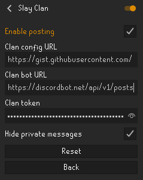
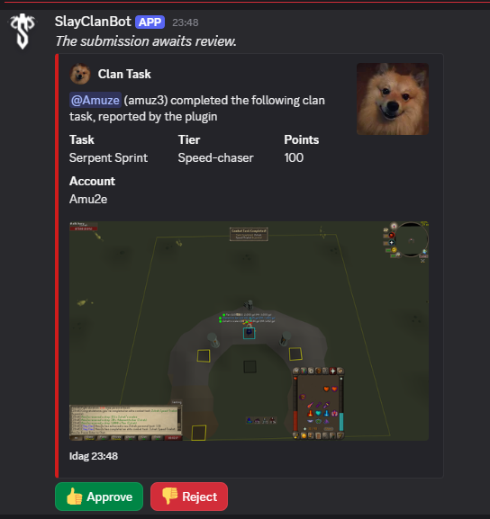

# Slay Clan

Posts your completed Slay Clan tasks to the clan Discord for you. Finish a task from the clan task sheet, like a clan raid, a speed kill, a new collection log item or a valuable drop, and the plugin sends it with a screenshot. Staff approve it as usual.

## Getting started

1. Install **Slay Clan** from the Plugin Hub.
2. Paste the config URL and the bot URL from the clan Discord into **Clan config URL** and **Clan bot URL**. Ask staff if you cannot find them.
3. Run `/plugin token` in the Slay Clan Discord and paste the answer into **Clan token**. It proves the posts are yours, so keep it to yourself. If it leaks, run the command again and the old one stops working.
4. Turn on **Enable posting**.
5. Log in to RuneLite with a **RuneLite account** (top right of the window) and turn on **Sync** for your profile in the profile panel. The plugin uses it to remember which one-time tasks it already posted, across your main, your alts and other computers.
6. In the game settings, turn on **Collection log - New addition notification**.
7. Keep the built-in **Loot Tracker** plugin on. It is on by default.
8. Open your **collection log** once, so the plugin can post the one-time collection log tasks you already have.

Points go to your main when you play on an alt. Tasks and points are managed by the clan, so there is nothing to update yourself. Using several RuneLite profiles? Fill in the settings in each.

## What gets posted

- **One-time tasks** (Social, PvM, Speed-chaser, Clogging) the first time you complete them.
- **Repeatable tasks** every time.
- **Group tasks** only when everyone in the party is in the clan. Each player with the plugin posts their own, and the post names the clan members in the team.
- **Valuable drops** with the item and its value, and from a raid or an instanced boss also the clan members in the team and whether the whole team was in the clan. The bot asks you in its approval channel who you split with, or press On my own. Only you can answer.
- **Personal bests** with a screenshot, plus your fastest kill per team size, since the game keeps one personal best per boss. The plugin does not post a time the game only remembers from before. The bot decides what makes the board. When the clan starts a PB season, the fastest-kill memory starts over with it.
- **Activity**: new collection log items and combat achievements, your overall progress and your stored personal bests, including your Tombs of Amascut total records, for the members hub. These give no points on their own.

PvP loot and loot keys never count. Nothing is posted on Deadman, Leagues, speedrun, tournament or beta worlds.

Each post goes straight to the clan's bot with your token, in-game name, the task and a screenshot of your RuneLite window. Staff check the game's own lines in it (kill count, time, personal best, drop), so for that one frame the plugin opens a closed chatbox, or one on another tab, on the All tab (the Game tab while player chat is shown) with **Show game chat in screenshots**, and leaves every message written by a player out of it with **Hide player chat in screenshots**: public, private, friends chat, clan, guest clan and group chat, including your own. Game messages and clan broadcasts stay. Your tab, your closed chatbox and your chat are back right after the frame, so the chat flickers once. That flicker is expected; with **Show game chat in screenshots** off the tab is never switched and only the hidden lines blink. If the game draws no frame in time, the post goes without a screenshot rather than with your chat in it. **Hide private messages** also hides the split private chat above the chatbox, with your friends' login notices, when "Split friends private chat" is on in the game settings. All three are on by default. When something went wrong with a post, it also carries the plugin version and a short fixed code about that post, such as "screenshot failed" or which resend delivered it, so staff can see it on the review post; if the screenshot fails you are told in the chat. These are codes only, never your logs, files or anything about other players. Nothing else is sent. A task judged right after login waits until you close the welcome screen, so its screenshot shows you in the game. The bot answers at once and the plugin tells you in the chat: sent for review, refused and why, or waiting for your answer in Discord.

## What the plugin cannot see

- **Tasks done before you installed it**, unless the game remembers them. Collection log tasks are checked against your whole log when you open it, combat achievement tasks against your completed achievements and raid, boss and speed tasks against your stored personal bests when you log in, and tasks for worn or held items, experience and collection log slots the first time the plugin looks. Clan-only tasks need the clan team present, so those count only live. Submit the rest by hand.
- **Tasks outside the game**, like events, SOTW, BOTW, ROTM, recruiting and boosts. Submit those by hand as before.

## Reporting a bug

Report it in the clan's bug report channel. Not in Slay Clan? Open an issue on [GitHub](https://github.com/slay-clan/slay-clan/issues). Include:

- **Task** that should have been posted
- **What happened**: nothing posted, wrong task, wrong points or posted twice
- **When**: date and rough time
- **Screenshot** of the chat from that moment (scroll up if needed)
- **Raid or boss**: team size, mode and who was there
- **Log**: the `SlayClan` lines from `%USERPROFILE%\.runelite\logs\client.log` around that time

The log says why a task was skipped, and a drop worth at least the clan's minimum that was not posted leaves a line naming the item, its value and the reason, such as a stackable item. Submit the task by hand in the meantime.

If the bot cannot be reached, the post is kept and sent again later with its screenshot, which waits in the plugin's folder under `.runelite/plugin-data` until the bot has answered and is then deleted. Each game account keeps its own waiting posts, so two clients on one RuneLite account never send or overwrite each other's. Posts older than a week are dropped, their screenshots are cleared the next time the plugin tidies its folder, and the plugin tells you at login so you can submit them by hand.

## For clan staff

Tasks and points live in a JSON file the clan hosts, so they change without a plugin update. Players pick changes up within about 10 minutes. The bot's address is a plugin setting each player fills in, so the plugin only ever sends to an address the player chose. Nothing is tied to Slay Clan, so another clan can run the plugin with its own file and bot. See [docs/config.md](docs/config.md) and [docs/example-config.json](docs/example-config.json).

The file's `ignoredContent` list switches a boss or raid off within minutes if its game messages ever post the wrong thing.

The file holds no secrets. Staff revoke a member's token with `/plugin revoke`.

## Credits

Built for Slay Clan with help from [Claude Code](https://claude.com/claude-code).
