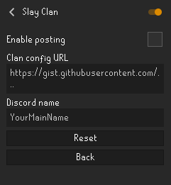

# Slay Clan

The Slay Clan plugin posts your completed clan tasks to the Slay Clan Discord automatically. When you finish a task from the clan task sheet, for example a clan-only raid, a speed kill, a new collection log item or a valuable drop, the plugin takes a screenshot and posts it together with the task name, tier and points. The clan staff then approve it as usual.

## Getting started

1. Install **Slay Clan** from the RuneLite Plugin Hub.
2. Open the plugin settings and paste the config URL from the clan Discord into **Clan config URL**. Ask a clan staff member if you cannot find it.
3. Fill in **Discord name** with your nickname in the Slay Clan Discord, which is your main's name. Posts and points use this name, also when you play on an alt.
4. Turn on **Enable posting** and accept the warning.
5. In the game settings, turn on **Collection log - New addition notification**. The popup setting does not matter. The plugin reminds you in chat at login when it is off.
6. Keep RuneLite's built-in **Loot Tracker** plugin enabled. It is on by default and the plugin reads drops from it.
7. Log in to RuneLite with a **RuneLite account**, using the login button at the top right of the RuneLite window. This is separate from your Jagex account and required for posting. The plugin also remembers which one-time tasks it has already posted, shared between your main and alts, and only a RuneLite account carries that memory over to other computers. The clan's bot refuses a one-time task you already have approved, so a duplicate never gives points twice, but the memory keeps the duplicate post from being made at all.
8. Open your **collection log** once. The plugin then sends your full log to the clan's activity feed, so the members hub knows what you already have. New items are sent as you get them.

That's it. Tasks and points are managed centrally by the clan, so you never have to update anything yourself.

If you use several RuneLite profiles, fill in the settings in each of them. One-time tasks are remembered per profile.

## What gets posted

- **One-time tasks** (Social, PvM, Speed-chaser and Clogging) are posted the first time the plugin sees you complete them.
- **Repeatable tasks** are posted every time.
- **Group tasks** such as clan raids only count when everyone in the party is a Slay Clan member. Everyone with the plugin posts their own completion, so the bot can award points per person.
- **Valuable drops** are posted with the item and its Grand Exchange value. The plugin cannot know who you split with, so the clan's bot asks you in point-approval: pick the others in the splitter list, or press On my own. You are always counted as a splitter yourself. Unlike the form you get from `/activity drop`, this one is not private: everyone in the channel can see it from the start, but only you can answer it, and it becomes the approval once you do. Staff can close a question you never answer.
- **PvP never counts.** Loot from other players and loot keys are ignored.
- **Activity feed** (when the clan has turned it on): every new collection log item and combat achievement, your combat achievement and collection log progress, and a full list of both when you log in or open your collection log. These go to a hidden channel the clan's bot reads; they are not clan task posts and give no points by themselves.
- **Personal bests** (when the clan has turned it on): a new personal best is posted with a screenshot. The game only keeps one personal best per boss, so the plugin also posts your fastest kill per team size since installing, and reports your current personal best once per boss, and once per raid each time you log in, so the PB leaderboard can be filled in. The post lists the team size and the clan members who were in your team, so the bot can give each of them their place on the board; nobody outside the clan is ever named. The bot decides what qualifies for the board. For a boss where the game does not say which team size your stored best was set at, the bot asks you in point-approval with one button per team size. Everyone can see the question, only you can press the buttons.

Each post contains your Discord name, the task details and a screenshot of your whole RuneLite window, including the chat. Nothing else is sent, and only to the clan Discord.

## What the plugin cannot see

- **Tasks you completed before installing the plugin.** The game only announces a new collection log item or combat achievement once, and the plugin does not post equipment or thresholds you had already reached. Submit those to the bot manually. The exception is a collection log task that needs several items, such as Pet Hoarder: the plugin checks it against your whole collection log when you open it, so items from before the install count.
- **Tasks outside the game**, such as clan events, SOTW, BOTW, ROTM, recruiting and Discord boosts. Submit those manually as before.

## Reporting a bug

When a task you completed was not posted, report it in the clan's bug report channel with:

- **Task:** the name of the task that should have been posted
- **What happened:** nothing was posted, wrong task, wrong points or posted twice
- **When:** date and approximate time
- **Screenshot:** the chat box showing the game messages from that moment. The chat history keeps them, so scroll up if needed
- **Raid or boss info:** team size, mode and who was in the party
- **Log:** the lines containing `SlayClan` from `%USERPROFILE%\.runelite\logs\client.log` around that time

The log says why the plugin skipped a task: posting blocked by a missing setting, config not loaded, not in the clan, an outsider in the party, a time or kill count that did not meet the task, a collection log item outside every task, or what happened to a Yama contract. It also records game messages it did not recognise. Submit the task manually to the bot in the meantime.

If Discord could not be reached, the post is kept and sent again at your next login or within 10 minutes, without the screenshot. Posts older than a week are dropped, and the plugin tells you at login how many were dropped so you can submit them manually. It also warns you in red at login when the clan config could not be loaded or when the Loot Tracker plugin is disabled.

## For clan staff

The tasks, points and Discord webhook live in a JSON file that the clan hosts, so they can be changed without updating the plugin. Players pick up changes within about 10 minutes. See [docs/config.md](docs/config.md) for every field and trigger, and [docs/example-config.json](docs/example-config.json) for a full example. The same file has an `ignoredContent` list: a boss or raid named there gives no kill, raid, contract or personal best post, which is how the clan switches new content off within minutes if its game messages turn out to post things they should not. Combat achievement, collection log and delve tasks are not affected by the list.

Anyone with the config URL can read the webhook. If it leaks, delete the webhook in Discord, create a new one and update the config file.

## Credits

Built for Slay Clan with help from [Claude Code](https://claude.com/claude-code).
