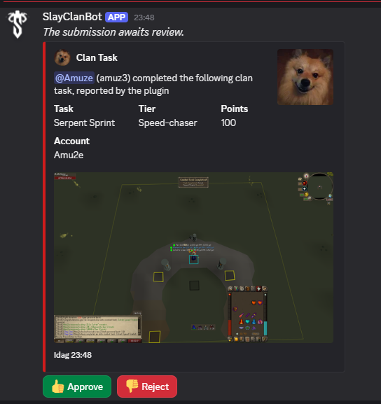

# Slay Clan

Posts your completed Slay Clan tasks to the clan Discord for you. Finish a task from the clan task sheet, like a clan raid, a speed kill, a new collection log item or a valuable drop, and the plugin sends it with a screenshot. Staff approve it as usual.

## Getting started

1. Install **Slay Clan** from the Plugin Hub.
2. Paste the config URL from the clan Discord into **Clan config URL**. Ask staff if you cannot find it.
3. Run `/plugin token` in the Slay Clan Discord and paste the answer into **Clan token**. It proves the posts are yours, so keep it to yourself. If it leaks, run the command again and the old one stops working.
4. Turn on **Enable posting**.
5. Log in to RuneLite with a **RuneLite account** (top right of the window) and turn on **Sync** for your profile in the profile panel. The plugin uses it to remember which one-time tasks it already posted, across your main, your alts and other computers.
6. In the game settings, turn on **Collection log - New addition notification**.
7. Keep the built-in **Loot Tracker** plugin on. It is on by default.
8. Open your **collection log** once, so the plugin can post the one-time collection log tasks you already have.

Points go to your main when you play on an alt. Tasks and points are managed by the clan, so there is nothing to update yourself. Using several RuneLite profiles? Fill in the settings in each.

## What gets posted

- **One-time tasks** (Social, PvM, Speed-chaser, Clogging) the first time you complete them.
- **Repeatable tasks** every time.
- **Group tasks** only when everyone in the party is in the clan. Each player with the plugin posts their own, and the post names the clan members in the team.
- **Valuable drops** with the item and its value. The bot asks you in its approval channel who you split with, or press On my own. Only you can answer.
- **Personal bests** with a screenshot, plus your fastest kill per team size and your current bests once, so the PB board can be filled in. The bot decides what makes the board, and asks you with buttons when it cannot tell a team size.
- **Activity**: new collection log items and combat achievements and your overall progress, for the members hub. These give no points on their own.

PvP loot and loot keys never count.

Each post goes straight to the clan's bot with your token, in-game name, the task and a screenshot of your RuneLite window, chat included. Nothing else is sent. The bot answers at once and the plugin tells you in the chat: sent for review, refused and why, or waiting for your answer in Discord.

## What the plugin cannot see

- **Tasks done before you installed it**, except collection log tasks, which are checked against your whole log when you open it. Submit the rest by hand.
- **Tasks outside the game**, like events, SOTW, BOTW, ROTM, recruiting and boosts. Submit those by hand as before.

## Reporting a bug

Report it in the clan's bug report channel. Not in Slay Clan? Open an issue on [GitHub](https://github.com/slay-clan/slay-clan/issues). Include:

- **Task** that should have been posted
- **What happened**: nothing posted, wrong task, wrong points or posted twice
- **When**: date and rough time
- **Screenshot** of the chat from that moment (scroll up if needed)
- **Raid or boss**: team size, mode and who was there
- **Log**: the `SlayClan` lines from `%USERPROFILE%\.runelite\logs\client.log` around that time

The log says why a task was skipped. Submit the task by hand in the meantime.

If the bot cannot be reached, the post is kept and sent again later without the screenshot. Posts older than a week are dropped, and the plugin tells you at login so you can submit them by hand.

## For clan staff

Tasks, points and the bot's address live in a JSON file the clan hosts, so they change without a plugin update. Players pick changes up within about 10 minutes. Nothing is tied to Slay Clan, so another clan can run the plugin with its own file and bot. See [docs/config.md](docs/config.md) and [docs/example-config.json](docs/example-config.json).

The file's `ignoredContent` list switches a boss or raid off within minutes if its game messages ever post the wrong thing.

The file holds no secrets. Staff revoke a member's token with `/plugin revoke`.

## Credits

Built for Slay Clan with help from [Claude Code](https://claude.com/claude-code).
